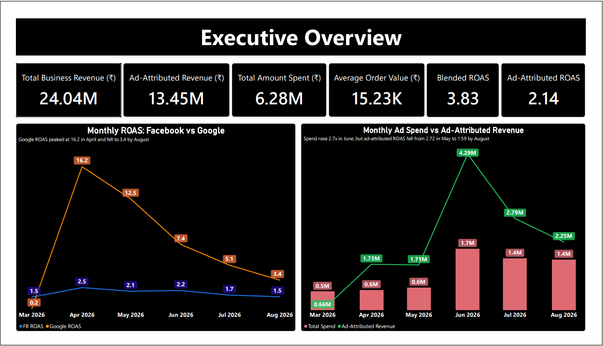
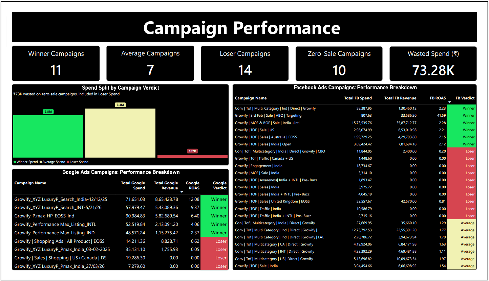
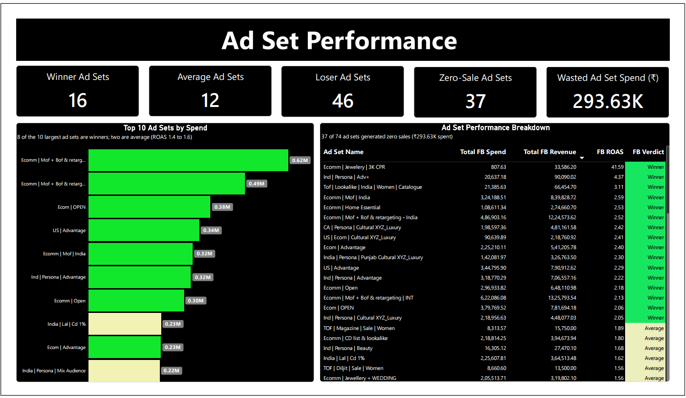
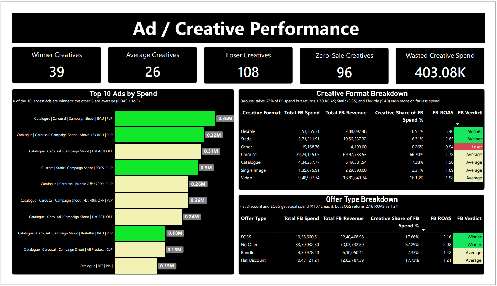
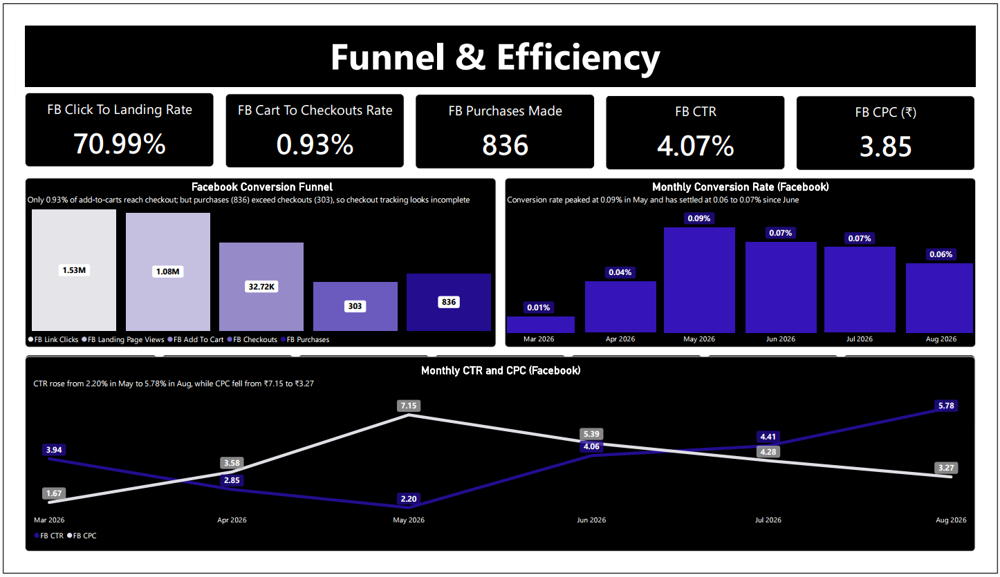
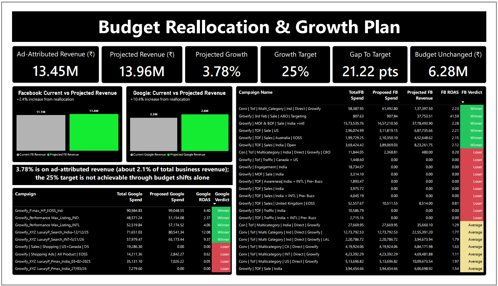

# Ad Spend Audit & Budget Reallocation: Facebook vs Google

> **₹62.8L ad spend audited. Google returned a ROAS of 5.86 against Facebook's 1.89, yet Facebook received 93.67% of the budget.**

**Tools:** Power BI (DAX, Power Query) · Excel (Power Query, Power Pivot) · Facebook & Google Ads data · Shopify sales data
**Period analysed:** March – August 2026

> *Self-completed case study based on the Growify Digital Associate Data Analyst assessment. It was not submitted to the company. Raw datasets are not included in this repository.*

---

## Business Problem

The client wanted to **grow sales by 25% without increasing the marketing budget**. The task: find where the spend is working, where it is wasted, and whether reallocation alone can hit the target.

## Headline Numbers

| Metric | Value |
|---|---|
| Total ad spend | ₹62.8 L (Facebook ₹58.8 L, Google ₹3.98 L) |
| Total business revenue | ₹2.40 Cr |
| Ad-attributed revenue | ₹1.35 Cr |
| Blended ROAS | 3.83 |
| Average order value | ₹15,226 |
| Scope | 32 campaigns (23 Facebook, 9 Google), 74 ad sets, 173 ads |

## Key Findings

1. **Budget is misallocated.** Google earns ROAS 5.86 (conversion rate 0.30%) on about 6% of spend. Facebook earns 1.89 (conversion rate 0.05%) on 93.67%.
2. **Efficiency falls as spend scales.** Both platforms peaked in April. By August, Google fell from 16.17 to 3.37 and Facebook from 2.53 to 1.50, consistent with audience saturation.
3. **Waste is concentrated.** 46 of 74 ad sets are losers, and 37 generated no sales (₹2.94 L spent). 96 ads had zero purchases (₹4.03 L spent).
4. **Creative and offer mix matter.** Carousel takes 66.7% of Facebook spend at ROAS 1.78, while Static (2.85) and Flexible (5.40) earn more on less spend. EOSS and Flat Discount get equal spend (₹10.4 L each), but EOSS returns 2.16 against 1.21.
5. **Fatigue signal.** Facebook CTR rose from 2.20% to 5.78% (May to Aug) while conversion rate fell from 0.09% to 0.06%. Clicks got cheaper but less likely to buy.
6. **Funnel leak and tracking gap** between add to cart and checkout.

## Recommendation

- Reallocate the unchanged ₹62.8 L: scale Google Search and winning ad sets in measured steps (about 5 to 12%), cut clear losers by 80%, and stop 10 zero-sale campaigns (₹73,280 reclaimed).
- **Result:** ad-attributed revenue rises **3.78%** (₹1.345 Cr to ₹1.396 Cr).
- **The +25% target cannot be reached by reallocation alone.** It also needs a checkout and tracking fix, AOV recovery, a creative and offer shift, and new audiences over a longer horizon.

## Power BI Report

- 7-page report: Performance → Winners → Losers → Problems → Opportunities → Recommended Actions
- Star schema: a central `DateTable` linked to three fact tables (Facebook, Google, Shopify)
- **70 DAX measures** and 2 calculated columns, fully documented in `DAX_Measures.xlsx`

## Dashboard Preview

### 1. Executive Overview

### 2. Channel Performance

### 3. Campaign Performance

### 4. Ad Set Performance

### 5. Ad Creative Performance

### 6. Funnel and Efficiency

### 7. Budget Reallocation and Growth Plan

## Video Walkthroughs

- ▶ Dashboard, desktop view: https://youtu.be/U88NvBqRqmM
- ▶ DAX Measures & DOC Assessment: https://youtu.be/kM66UQYd6Aw
- ▶ DAX measures, schema and Power Query: https://youtu.be/919vq1OO2hc
- ▶ Excel: Power Query, Power Pivot and formulas: https://youtu.be/bjYAysMMeuM

## Repository Contents

| File | Description |
|---|---|
| `Growify_Shopify_PowerBI.pdf` | PDF export of the 7-page dashboard |
| `Growify_Full_Assessment_Final.docx` | Full report: analysis, reallocation plan, 25% growth challenge |
| `DAX_Measures.xlsx` | Every DAX measure with description and change log |
| `screenshots/` | Dashboard and data model images |

## Author

**Sushant Kumar Yadav** · Data & Financial Analyst (fresher)
[LinkedIn](https://www.linkedin.com/in/sushantkumaryadav310899/) · [GitHub](https://github.com/Skysushant7366)
